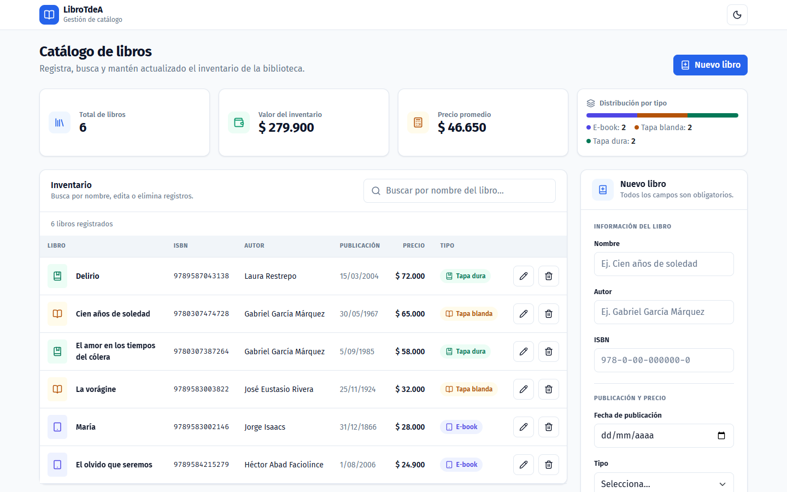
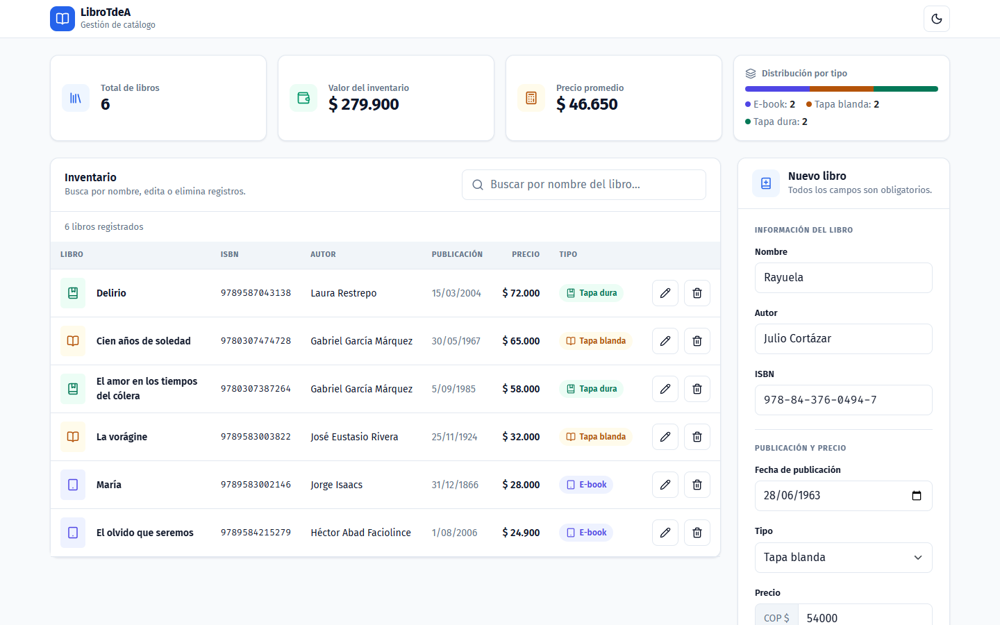
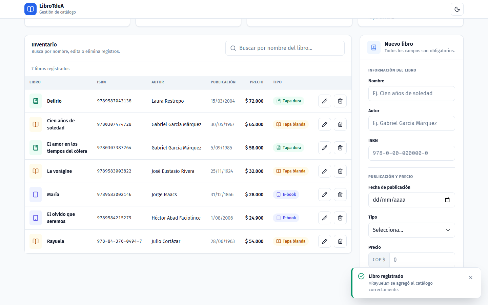
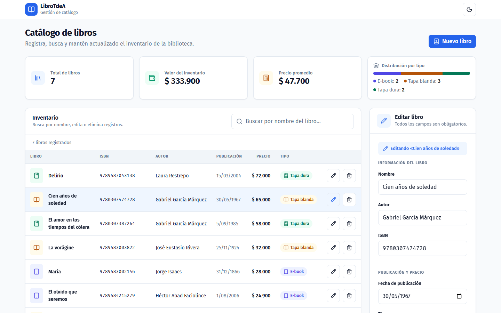
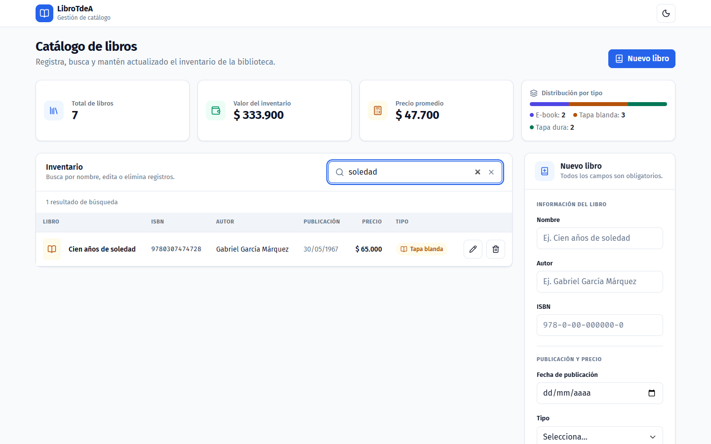
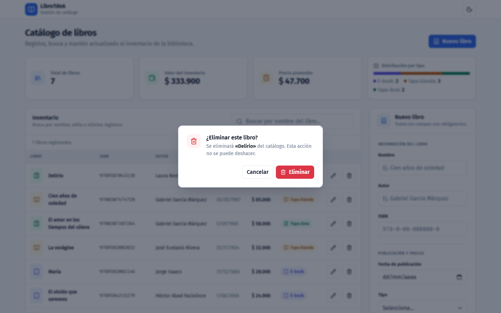
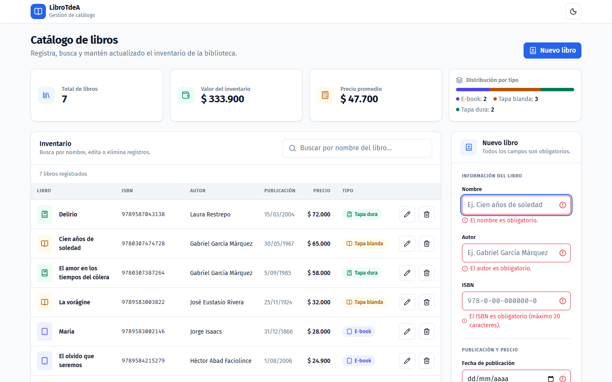
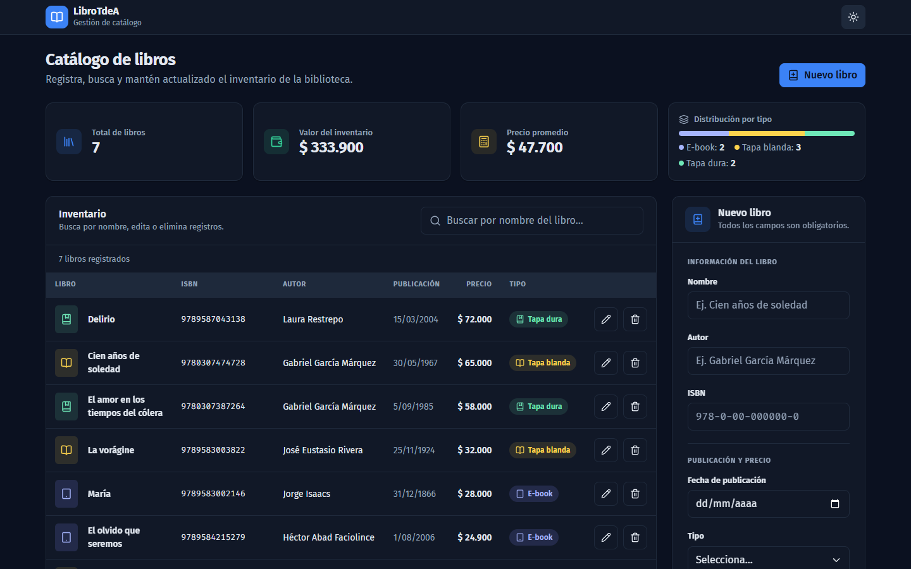
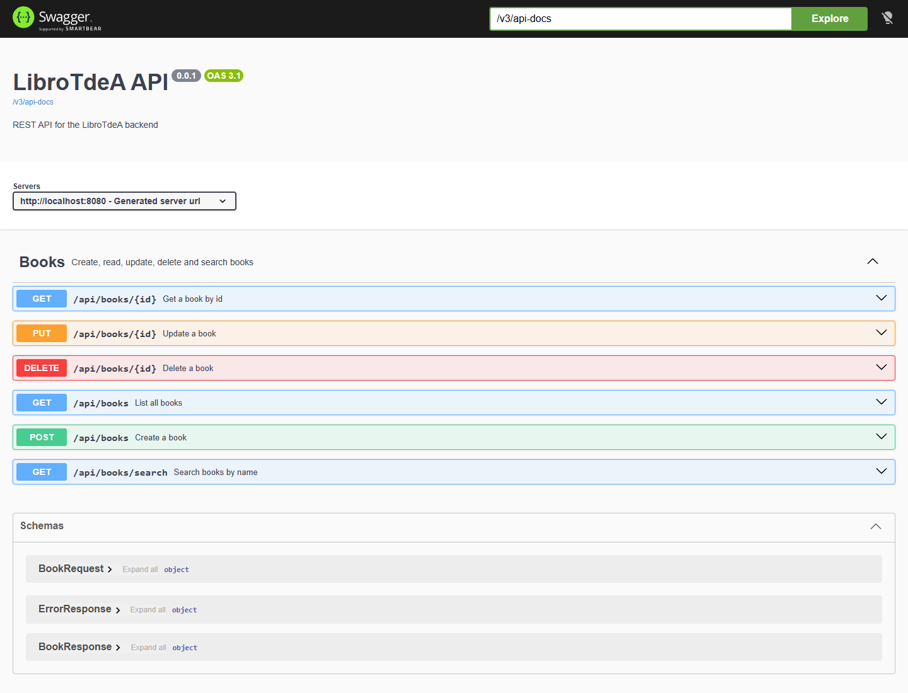
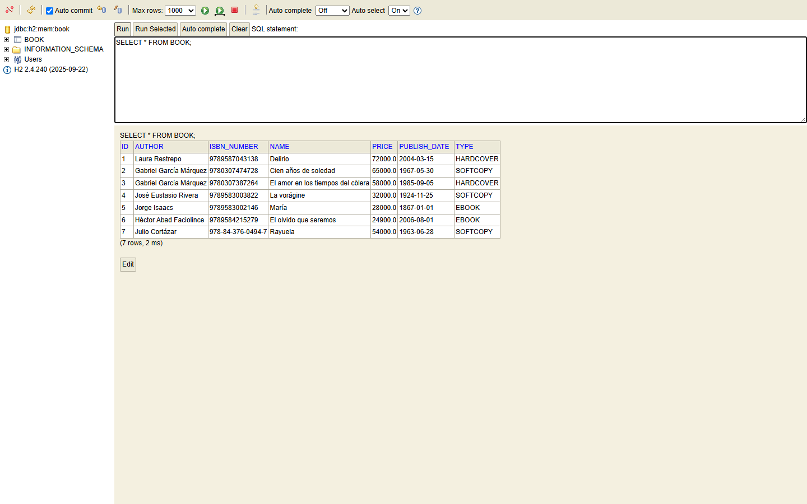

# LibroTdeA

Aplicación web para gestionar el catálogo de libros de una biblioteca. Permite **registrar, listar,
buscar por nombre, editar y eliminar** libros, y muestra un resumen del inventario (total de libros,
valor del inventario, precio promedio y reparto por tipo).

El proyecto está dividido en dos aplicaciones:

- **Backend** (`librotdea/backend`): API REST con Spring Boot y base de datos H2.
- **Frontend** (`librotdea/frontend`): SPA con React + Vite que consume la API.

---

## Tabla de contenidos

1. [Stack tecnológico](#stack-tecnológico)
2. [Arquitectura](#arquitectura)
3. [Modelo de datos](#modelo-de-datos)
4. [Endpoints](#endpoints)
5. [Reglas de negocio](#reglas-de-negocio)
6. [Requisitos previos](#requisitos-previos)
7. [Configuración de la base de datos](#configuración-de-la-base-de-datos)
8. [Ejecución](#ejecución)
9. [Capturas](#capturas)

---

## Stack tecnológico

### Backend

Versiones tomadas de [`librotdea/backend/pom.xml`](librotdea/backend/pom.xml) (el proyecto usa
**Maven** con wrapper incluido, no Gradle).

| Tecnología | Versión | Uso |
|---|---|---|
| Java | 25 | Lenguaje |
| Spring Boot (parent) | 4.1.2 | Framework base |
| Spring Web MVC (`spring-boot-starter-webmvc`) | gestionada por Boot 4.1.2 | API REST |
| Spring Data JPA (`spring-boot-starter-data-jpa`) | gestionada por Boot 4.1.2 | Persistencia / Hibernate |
| Jakarta Validation (`spring-boot-starter-validation`) | gestionada por Boot 4.1.2 | Validación de DTOs |
| Spring Boot Actuator | gestionada por Boot 4.1.2 | `/actuator/health` |
| H2 Database + H2 Console (`spring-boot-h2console`) | gestionada por Boot 4.1.2 | Base de datos |
| springdoc-openapi-starter-webmvc-ui | 3.2.0 | Swagger UI / OpenAPI |
| Lombok | gestionada por Boot 4.1.2 | Getters/setters/constructores de la entidad |
| Spring Boot DevTools | gestionada por Boot 4.1.2 | Recarga en desarrollo |
| Maven Wrapper | incluido (`mvnw`, `mvnw.cmd`) | Compilación |

### Frontend

Versiones tomadas de [`librotdea/frontend/package.json`](librotdea/frontend/package.json).

| Tecnología | Versión | Uso |
|---|---|---|
| React / React DOM | ^19.3.1 | Librería de UI |
| Vite | ^8.3.6 | Servidor de desarrollo y build |
| @vitejs/plugin-react | ^6.1.2 | Soporte de React en Vite |
| Axios | ^1.21.1 | Cliente HTTP |
| Bootstrap | ^5.3.9 | Estilos y componentes (incluye tema claro/oscuro) |
| lucide-react | ^1.76.0 | Iconos |
| temporal-polyfill | ^1.0.8 | Fechas sin zona horaria (`Temporal.PlainDate`) |
| @fontsource/fira-sans, @fontsource/fira-code | ^5.3.0 | Tipografías |
| oxlint | ^1.90.0 | Linter |

---

## Arquitectura

```
┌──────────────────────┐   HTTP/JSON (Axios)   ┌───────────────────────────────┐
│  Frontend React      │ ────────────────────► │  Backend Spring Boot          │
│  http://localhost:3000│ ◄──────────────────── │  http://localhost:8080/api    │
└──────────────────────┘        CORS            │  Controller → Service → Repo  │
                                                └──────────────┬────────────────┘
                                                               │ JPA / Hibernate
                                                        ┌──────▼──────┐
                                                        │   H2 (book) │
                                                        └─────────────┘
```

### Backend: arquitectura en capas

Paquete raíz `com.tdea.librotdea`:

| Capa / paquete | Clases | Responsabilidad |
|---|---|---|
| `controller` | `BookController` | Expone `/api/books`. Solo maneja HTTP (códigos, cabeceras) y delega en el service. Recibe y devuelve DTOs, nunca entidades. |
| `service` | `BookService` | Lógica de negocio y transacciones (`@Transactional`). Convierte entre DTO y entidad y lanza excepciones de dominio. |
| `repository` | `BookRepository` | `JpaRepository<Book, Long>` + consulta derivada `findByNameContainingIgnoreCase`. |
| `entity` | `Book`, `BookType` | Entidad JPA (tabla `book`) y enum del formato del libro. |
| `dto` | `BookRequest`, `BookResponse`, `ErrorResponse` | `record`s de entrada (con validaciones), salida y error estándar. |
| `exception` | `GlobalExceptionHandler`, `ResourceNotFoundException` | Manejo centralizado de errores con `@RestControllerAdvice`. |
| `config` | `CorsConfig`, `OpenApiConfig` | CORS para `http://localhost:3000` y metadatos de Swagger. |

Flujo de una petición: `BookController` → `BookService` → `BookRepository` → H2. Los errores
lanzados en cualquier capa los transforma `GlobalExceptionHandler` en un `ErrorResponse`.

```
librotdea/backend/
├── pom.xml
├── mvnw / mvnw.cmd
└── src/main/
    ├── java/com/tdea/librotdea/
    │   ├── LibrotdeaApplication.java
    │   ├── config/        CorsConfig, OpenApiConfig
    │   ├── controller/    BookController
    │   ├── dto/           BookRequest, BookResponse, ErrorResponse
    │   ├── entity/        Book, BookType
    │   ├── exception/     GlobalExceptionHandler, ResourceNotFoundException
    │   ├── repository/    BookRepository
    │   └── service/       BookService
    └── resources/
        ├── application.yml                        # perfil default
        └── application-local.properties.example  # plantilla del perfil local
```

### Frontend: estructura

Aplicación de una sola pantalla: resumen del catálogo, tabla con buscador y formulario de alta/edición.

```
librotdea/frontend/
├── index.html
├── vite.config.js            # servidor en el puerto 3000 (strictPort)
├── .env.example              # VITE_API_URL
└── src/
    ├── main.jsx              # punto de entrada; carga Bootstrap, fuentes y el polyfill de Temporal
    ├── App.jsx               # pantalla principal: estado, tema claro/oscuro y notificaciones
    ├── index.css             # estilos propios
    ├── services/
    │   └── BookService.js    # cliente Axios para /api/books
    └── components/
        ├── BookStats.jsx         # tarjetas de resumen (total, valor, promedio, tipos)
        ├── BookList.jsx          # tabla de libros + confirmación de borrado (<dialog>)
        ├── BookSearch.jsx        # búsqueda por nombre mientras se escribe
        ├── BookForm.jsx          # formulario de crear/editar con validación
        ├── TypeBadge.jsx         # etiqueta del tipo de libro
        ├── bookFormat.js         # formato de precio (COP) y fecha, tipos y mensajes de error
        └── useUserInvalidAria.js # accesibilidad de los errores del formulario
```

---

## Modelo de datos

### Entidad `Book` (tabla `book`)

| Campo | Tipo Java | Columna | Restricciones |
|---|---|---|---|
| `id` | `Long` | `id` | PK, autogenerado (`IDENTITY`) |
| `name` | `String` | `name` | Obligatorio, máx. 255 |
| `isbnNumber` | `String` | `isbn_number` | Obligatorio, máx. 20 |
| `author` | `String` | `author` | Obligatorio, máx. 255 |
| `publishDate` | `LocalDate` | `publish_date` | Obligatorio, no puede ser futura |
| `price` | `Double` | `price` | Obligatorio, mayor que 0 |
| `type` | `BookType` | `type` | Obligatorio, guardado como texto (`EnumType.STRING`) |

Las restricciones se validan en `BookRequest`; el esquema lo crea/actualiza Hibernate
(`ddl-auto: update`).

### Enum `BookType`

| Valor | Significado | Etiqueta en el frontend |
|---|---|---|
| `EBOOK` | Edición digital | E-book |
| `SOFTCOPY` | Tapa blanda | Tapa blanda |
| `HARDCOVER` | Tapa dura | Tapa dura |

### Cuerpo de error `ErrorResponse`

| Campo | Tipo | Descripción |
|---|---|---|
| `timestamp` | `Instant` | Momento del error |
| `status` | `int` | Código HTTP |
| `error` | `String` | Texto del código HTTP |
| `message` | `String` | Descripción legible |
| `path` | `String` | Ruta que produjo el error |
| `fieldErrors` | `Map<String,String>` | Errores de validación por campo (vacío si no hay) |

---

## Endpoints

URL base: `http://localhost:8080/api/books`. Documentación interactiva en
**Swagger UI**: <http://localhost:8080/swagger-ui.html> (JSON OpenAPI en `/v3/api-docs`).

| Método | Ruta | Descripción | Respuestas |
|---|---|---|---|
| `GET` | `/api/books` | Lista todos los libros | 200 |
| `GET` | `/api/books/{id}` | Obtiene un libro por id | 200, 400, 404 |
| `GET` | `/api/books/search?name={texto}` | Busca por nombre (contiene, sin distinguir mayúsculas) | 200, 204 |
| `POST` | `/api/books` | Crea un libro | 201, 400 |
| `PUT` | `/api/books/{id}` | Reemplaza los datos de un libro | 200, 400, 404 |
| `DELETE` | `/api/books/{id}` | Elimina un libro | 204, 400, 404 |

### Crear un libro

```http
POST /api/books
Content-Type: application/json

{
  "name": "Cien años de soledad",
  "isbnNumber": "9780307474728",
  "author": "Gabriel García Márquez",
  "publishDate": "1967-05-30",
  "price": 65000,
  "type": "SOFTCOPY"
}
```

Respuesta `201 Created` (cabecera `Location: http://localhost:8080/api/books/1`):

```json
{
  "id": 1,
  "name": "Cien años de soledad",
  "isbnNumber": "9780307474728",
  "author": "Gabriel García Márquez",
  "publishDate": "1967-05-30",
  "price": 65000.0,
  "type": "SOFTCOPY"
}
```

### Listar todos

```http
GET /api/books
```

Respuesta `200 OK`:

```json
[
  {
    "id": 1,
    "name": "Cien años de soledad",
    "isbnNumber": "9780307474728",
    "author": "Gabriel García Márquez",
    "publishDate": "1967-05-30",
    "price": 65000.0,
    "type": "SOFTCOPY"
  }
]
```

### Obtener por id

```http
GET /api/books/1
```

Respuesta `200 OK`: el mismo objeto del ejemplo anterior. Si no existe, `404 Not Found`:

```json
{
  "timestamp": "2026-11-21T15:04:05.123Z",
  "status": 404,
  "error": "Not Found",
  "message": "Book with id 99 not found",
  "path": "/api/books/99",
  "fieldErrors": {}
}
```

### Buscar por nombre

```http
GET /api/books/search?name=soledad
```

Respuesta `200 OK` con la lista de coincidencias, o `204 No Content` (sin cuerpo) si ninguna coincide.

### Actualizar

```http
PUT /api/books/1
Content-Type: application/json

{
  "name": "Cien años de soledad (edición conmemorativa)",
  "isbnNumber": "9788420471839",
  "author": "Gabriel García Márquez",
  "publishDate": "2017-03-01",
  "price": 89000,
  "type": "HARDCOVER"
}
```

Respuesta `200 OK`:

```json
{
  "id": 1,
  "name": "Cien años de soledad (edición conmemorativa)",
  "isbnNumber": "9788420471839",
  "author": "Gabriel García Márquez",
  "publishDate": "2017-03-01",
  "price": 89000.0,
  "type": "HARDCOVER"
}
```

### Eliminar

```http
DELETE /api/books/1
```

Respuesta `204 No Content` (sin cuerpo), o `404 Not Found` si el libro no existe.

### Error de validación

```http
POST /api/books
Content-Type: application/json

{ "name": "", "isbnNumber": "123", "author": "Anónimo", "publishDate": "2999-01-01", "price": -5, "type": "EBOOK" }
```

Respuesta `400 Bad Request`:

```json
{
  "timestamp": "2026-11-21T15:04:05.123Z",
  "status": 400,
  "error": "Bad Request",
  "message": "Validation failed",
  "path": "/api/books",
  "fieldErrors": {
    "name": "name is required",
    "publishDate": "publishDate cannot be in the future",
    "price": "price must be greater than zero"
  }
}
```

Otros `400`: JSON mal formado, fecha inválida o `type` desconocido → `"Malformed request body"`;
id no numérico (p. ej. `/api/books/abc`) → `"Invalid value for parameter 'id'"`.
Cualquier error no previsto devuelve `500` con `"Unexpected error"`.

---

## Reglas de negocio

1. **Todos los campos son obligatorios**: nombre, ISBN, autor, fecha de publicación, precio y tipo.
2. **Longitudes máximas**: nombre y autor ≤ 255 caracteres; ISBN ≤ 20 caracteres.
3. **La fecha de publicación no puede ser futura** (`@PastOrPresent`). El formulario limita el
   selector de fecha al día de hoy.
4. **El precio debe ser mayor que cero** (`@Positive`).
5. **El tipo solo puede ser** `EBOOK`, `SOFTCOPY` o `HARDCOVER`.
6. **El id lo genera la base de datos**; no se envía al crear ni se puede cambiar al actualizar.
7. **La actualización es completa** (`PUT`): se reemplazan todos los campos del libro.
8. **Actualizar o eliminar un libro inexistente** devuelve `404`.
9. **La búsqueda por nombre** encuentra coincidencias parciales sin distinguir mayúsculas; si no hay
   resultados responde `204` y el frontend muestra la tabla vacía.
10. **Eliminar pide confirmación** en el frontend antes de llamar a la API.
11. **Formato en pantalla**: los precios se muestran en pesos colombianos (COP, sin decimales) y las
    fechas en formato `es-CO`.
12. **Todas las respuestas de error** siguen el formato `ErrorResponse`; el frontend muestra el
    mensaje y los errores por campo en una notificación.

---

## Requisitos previos

| Herramienta | Versión | Comprobar |
|---|---|---|
| JDK | 25 | `java -version` |
| Node.js | 20.19+ o 22.12+ (requisito de Vite 8; probado con 24.x) | `node -v` |
| npm | el incluido con Node | `npm -v` |
| Git | cualquiera reciente | `git --version` |

No hace falta instalar Maven (se usa el wrapper `mvnw`) ni un servidor de base de datos (H2 va
embebido).

---

## Configuración de la base de datos

El backend usa **H2** y tiene dos perfiles de Spring.

### Perfil `default` (en memoria)

Es el que se usa si no se indica ningún perfil. Está en
[`src/main/resources/application.yml`](librotdea/backend/src/main/resources/application.yml):

```yaml
spring:
  datasource:
    url: jdbc:h2:mem:book
    username: sa
    password: sa
  jpa:
    database-platform: org.hibernate.dialect.H2Dialect
    hibernate:
      ddl-auto: update
    show-sql: true
  h2:
    console:
      enabled: true
```

- La base vive en memoria: **los datos se pierden al detener la aplicación**.
- La tabla `book` la crea Hibernate al arrancar.
- Consola H2: <http://localhost:8080/h2-console> con JDBC URL `jdbc:h2:mem:book`, usuario `sa`,
  contraseña `sa`.

### Perfil `local` (en archivo, persistente)

Sirve para conservar los datos entre ejecuciones o usar credenciales propias. Su archivo
**no se sube al repositorio** (está en `.gitignore`), así que cada persona lo crea a partir de la
plantilla:

```bash
cd librotdea/backend/src/main/resources
cp application-local.properties.example application-local.properties
```

Contenido de la plantilla
([`application-local.properties.example`](librotdea/backend/src/main/resources/application-local.properties.example)):

```properties
spring.datasource.url=jdbc:h2:file:./data/librotdea;AUTO_SERVER=TRUE
spring.datasource.username=sa
spring.datasource.password=cambia-esta-contrasena
spring.jpa.hibernate.ddl-auto=update
spring.jpa.show-sql=false
```

Las propiedades del perfil `local` se suman a las del `default` y reemplazan las que coinciden.
Los datos quedan en `librotdea/backend/data/` (también ignorado por Git). En la consola H2 usa
la JDBC URL `jdbc:h2:file:./data/librotdea`.

Para activarlo, ejecuta el backend con el perfil `local` (ver la sección siguiente).

> Para usar otro motor (MySQL, PostgreSQL…) añade su driver al `pom.xml` y cambia la URL,
> el dialecto y las credenciales en `application-local.properties`.

---

## Ejecución

### 1. Backend

```bash
cd librotdea/backend

# Perfil default (H2 en memoria)
./mvnw spring-boot:run            # Windows: .\mvnw.cmd spring-boot:run

# Perfil local (H2 en archivo)
./mvnw spring-boot:run -Dspring-boot.run.profiles=local
# Windows PowerShell: .\mvnw.cmd spring-boot:run "-Dspring-boot.run.profiles=local"
```

Queda disponible en <http://localhost:8080>:

| Recurso | URL |
|---|---|
| API | <http://localhost:8080/api/books> |
| Swagger UI | <http://localhost:8080/swagger-ui.html> |
| Consola H2 | <http://localhost:8080/h2-console> |
| Health | <http://localhost:8080/actuator/health> |

Otros comandos: `./mvnw compile` (compilar), `./mvnw test` (tests), `./mvnw package` (genera el JAR en
`target/`; se ejecuta con `java -jar target/librotdea-0.0.1-SNAPSHOT.jar --spring.profiles.active=local`).

### 2. Frontend

```bash
cd librotdea/frontend
cp .env.example .env      # define VITE_API_URL=http://localhost:8080/api
npm install
npm run dev
```

Abre <http://localhost:3000>. El puerto es fijo porque el backend solo acepta peticiones CORS desde
`http://localhost:3000`.

Otros scripts: `npm run build` (genera `dist/`), `npm run preview` (sirve el build) y `npm run lint`.

> Arranca primero el backend; si no está en marcha, el frontend muestra
> “No se pudo conectar con el servidor”.

---

## Capturas

Capturas tomadas con la aplicación en ejecución (perfil `default`, con libros de ejemplo).
Las imágenes están en [`docs/capturas/`](docs/capturas/).

### Pantalla principal



### Registrar un libro





### Editar un libro



### Búsqueda por nombre



### Confirmación de borrado



### Errores de validación



### Tema oscuro



### Swagger UI



### Consola H2


